<picture><source media="(prefers-color-scheme: dark)" srcset="assets/dark/header-v1.svg"/></picture>

  <a href="mailto:pranilshah08@gmail.com"><picture><source media="(prefers-color-scheme: dark)" srcset="https://img.shields.io/badge/EMAIL-pranilshah08%40gmail.com-0e0f14?style=flat-square&logo=gmail&logoColor=38bdf8"/></picture></a>
  &nbsp;
  <a href="https://linkedin.com/in/YOUR_LINKEDIN" target="_blank"><picture><source media="(prefers-color-scheme: dark)" srcset="https://img.shields.io/badge/LINKEDIN-Connect-0e0f14?style=flat-square&logo=linkedin&logoColor=38bdf8"/></picture></a>
  &nbsp;
  <a href="https://github.com/PranilShah-08"><picture><source media="(prefers-color-scheme: dark)" srcset="https://img.shields.io/badge/GITHUB-PranilShah--08-0e0f14?style=flat-square&logo=github&logoColor=38bdf8"/></picture></a>

<picture><source media="(prefers-color-scheme: dark)" srcset="assets/dark/now.svg"/></picture>

 

<picture><source media="(prefers-color-scheme: dark)" srcset="assets/dark/s01.svg"/></picture>
<picture><source media="(prefers-color-scheme: dark)" srcset="assets/dark/whoami.svg"/></picture>

  

<picture><source media="(prefers-color-scheme: dark)" srcset="assets/dark/s02.svg"/></picture>

  <a href="https://github.com/PranilShah-08/break-your-model"><picture><source media="(prefers-color-scheme: dark)" srcset="assets/dark/p-breakyourmodel.svg"/></picture></a>
  &nbsp;
  <a href="https://github.com/PranilShah-08/Nested-Adversarial-Containment"><picture><source media="(prefers-color-scheme: dark)" srcset="assets/dark/p-nestedadversarial.svg"/></picture></a>

  <a href="https://github.com/PranilShah-08/ONIX-Council"><picture><source media="(prefers-color-scheme: dark)" srcset="assets/dark/p-onixcouncil.svg"/></picture></a>
  &nbsp;
  <a href="https://github.com/PranilShah-08/codecritic"><picture><source media="(prefers-color-scheme: dark)" srcset="assets/dark/p-codecritic.svg"/></picture></a>

 

<picture><source media="(prefers-color-scheme: dark)" srcset="assets/dark/s03.svg"/></picture>
<picture><source media="(prefers-color-scheme: dark)" srcset="assets/dark/telemetry.svg"/></picture>

  

<picture><source media="(prefers-color-scheme: dark)" srcset="assets/dark/s04.svg"/></picture>
<picture><source media="(prefers-color-scheme: dark)" srcset="assets/dark/stack.svg"/></picture>

  

<picture><source media="(prefers-color-scheme: dark)" srcset="assets/dark/s05.svg"/></picture>
<picture><source media="(prefers-color-scheme: dark)" srcset="assets/dark/snake.svg"/></picture>

  

<picture><source media="(prefers-color-scheme: dark)" srcset="assets/dark/s06.svg"/></picture>
<a href="https://linkedin.com/in/YOUR_LINKEDIN" target="_blank"><picture><source media="(prefers-color-scheme: dark)" srcset="assets/dark/card-linkedin.svg"/></picture></a>

  

<picture><source media="(prefers-color-scheme: dark)" srcset="assets/dark/s07.svg"/></picture>
<a href="mailto:pranilshah08@gmail.com?subject=Hello%20Pranil%20%7C%20AI%20Research%20%26%20Collaboration"><picture><source media="(prefers-color-scheme: dark)" srcset="assets/dark/card-gmail.svg"/></picture></a>

  

<picture><source media="(prefers-color-scheme: dark)" srcset="assets/dark/footer.svg"/></picture>

<!-- one responsive picture per visual; fully unified Victor Studios card system -->
