<picture><source media="(prefers-color-scheme: dark)" srcset="assets/dark/header-v1.svg"/></picture>

  <a href="mailto:pranilshah08@gmail.com"><picture><source media="(prefers-color-scheme: dark)" srcset="https://img.shields.io/badge/EMAIL-pranilshah08%40gmail.com-0e0f14?style=flat-square&logo=gmail&logoColor=38bdf8"/></picture></a>
  &nbsp;
  <a href="https://www.linkedin.com/in/pranil-shah-721b2033a/" target="_blank"><picture><source media="(prefers-color-scheme: dark)" srcset="https://img.shields.io/badge/LINKEDIN-pranil--shah--721b2033a-0e0f14?style=flat-square&logo=linkedin&logoColor=38bdf8"/></picture></a>
  &nbsp;
  <a href="https://scholar.google.com/citations?user=m6K4nKEAAAAJ&hl=en" target="_blank"><picture><source media="(prefers-color-scheme: dark)" srcset="https://img.shields.io/badge/SCHOLAR-Pranil%20Shah-0e0f14?style=flat-square&logo=googlescholar&logoColor=38bdf8"/></picture></a>
  &nbsp;
  <a href="https://www.researchgate.net/profile/Pranil-Shah?ev=hdr_xprf" target="_blank"><picture><source media="(prefers-color-scheme: dark)" srcset="https://img.shields.io/badge/RESEARCHGATE-Pranil%20Shah-0e0f14?style=flat-square&logo=researchgate&logoColor=38bdf8"/></picture></a>
  &nbsp;
  <a href="https://github.com/PranilShah-08"><picture><source media="(prefers-color-scheme: dark)" srcset="https://img.shields.io/badge/GITHUB-PranilShah--08-0e0f14?style=flat-square&logo=github&logoColor=38bdf8"/></picture></a>

 

<picture><source media="(prefers-color-scheme: dark)" srcset="assets/dark/s01.svg"/></picture>
<picture><source media="(prefers-color-scheme: dark)" srcset="assets/dark/whoami.svg"/></picture>

  

<picture><source media="(prefers-color-scheme: dark)" srcset="assets/dark/s02.svg"/></picture>
<picture><source media="(prefers-color-scheme: dark)" srcset="assets/dark/projects.svg"/></picture>

  

    <a href="https://github.com/PranilShah-08/break-your-model"><picture><source media="(prefers-color-scheme: dark)" srcset="https://img.shields.io/badge/01%20BREAK--YOUR--MODEL-0e0f14?style=flat-square&logo=github&logoColor=38bdf8"/></picture></a>
    &nbsp;
    <a href="https://github.com/PranilShah-08/Nested-Adversarial-Containment"><picture><source media="(prefers-color-scheme: dark)" srcset="https://img.shields.io/badge/02%20NESTED--ADVERSARIAL--CONTAINMENT-0e0f14?style=flat-square&logo=github&logoColor=38bdf8"/></picture></a>
    &nbsp;
    <a href="https://github.com/PranilShah-08/ONIX-Council"><picture><source media="(prefers-color-scheme: dark)" srcset="https://img.shields.io/badge/03%20ONIX--COUNCIL-0e0f14?style=flat-square&logo=github&logoColor=38bdf8"/></picture></a>
    &nbsp;
    <a href="https://github.com/PranilShah-08/codecritic"><picture><source media="(prefers-color-scheme: dark)" srcset="https://img.shields.io/badge/04%20CODECRITIC-0e0f14?style=flat-square&logo=github&logoColor=38bdf8"/></picture></a>
  

<picture><source media="(prefers-color-scheme: dark)" srcset="assets/dark/s03.svg"/></picture>
<picture><source media="(prefers-color-scheme: dark)" srcset="assets/dark/telemetry.svg"/></picture>

  

<picture><source media="(prefers-color-scheme: dark)" srcset="assets/dark/s04.svg"/></picture>
<picture><source media="(prefers-color-scheme: dark)" srcset="assets/dark/stack.svg"/></picture>

  

<picture><source media="(prefers-color-scheme: dark)" srcset="assets/dark/s05.svg"/></picture>
<picture><source media="(prefers-color-scheme: dark)" srcset="assets/dark/snake.svg"/></picture>

  

<picture><source media="(prefers-color-scheme: dark)" srcset="assets/dark/s06.svg"/></picture>
<a href="https://scholar.google.com/citations?user=m6K4nKEAAAAJ&hl=en" target="_blank"><picture><source media="(prefers-color-scheme: dark)" srcset="assets/dark/card-scholar.svg"/></picture></a>

  

<a href="https://www.researchgate.net/profile/Pranil-Shah?ev=hdr_xprf" target="_blank"><picture><source media="(prefers-color-scheme: dark)" srcset="assets/dark/card-researchgate.svg"/></picture></a>

  

<picture><source media="(prefers-color-scheme: dark)" srcset="assets/dark/s07.svg"/></picture>
<a href="https://www.linkedin.com/in/pranil-shah-721b2033a/" target="_blank"><picture><source media="(prefers-color-scheme: dark)" srcset="assets/dark/card-linkedin.svg"/></picture></a>

  

<picture><source media="(prefers-color-scheme: dark)" srcset="assets/dark/s08.svg"/></picture>
<a href="mailto:pranilshah08@gmail.com?subject=Hello%20Pranil%20%7C%20AI%20Research"><picture><source media="(prefers-color-scheme: dark)" srcset="assets/dark/card-gmail.svg"/></picture></a>

  

<picture><source media="(prefers-color-scheme: dark)" srcset="assets/dark/footer.svg"/></picture>

<!-- one responsive picture per visual; fully unified Victor Studios card system -->
